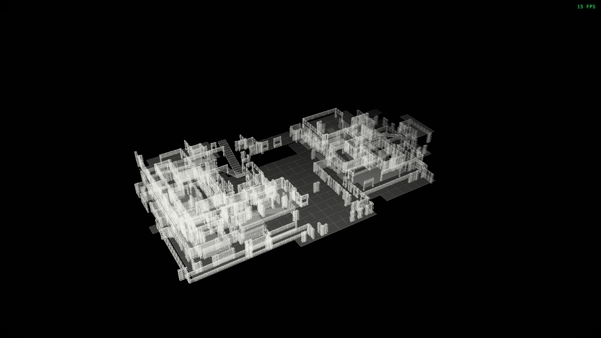

# Ink Ribbon

The real Raccoon Police Department geometry from *Resident Evil 2* (RT build),
floors 1–3, rendered in the browser with sokol compiled to WebAssembly. The
surfaces are not textured; each source material uses one simple flat colour.
Orbit the model, pan it, or hold right-click and fly through it.

A second scene at **`/blockout`** is a simplified architectural blockout of the
same floors: white wireframe over black, translucent near surfaces, dim floor
grids and simple stair planes. The real scene is untouched. A green FPS counter
sits at the top right of both scenes.




## What is in here

- **Level data** — all 49 RPD terrain meshes for 1F, 2F and 3F, read directly
  from the game's PAK archives at LOD 0. This is the real level geometry: walls,
  floors, stairs, props, railings, roofs and the clock tower. There is no
  simplification pass and no texture data. The only removals are triangles
  outside the RPD clip box, degenerates, and flat top-envelope surfaces.
- **Renderer** — a C application using the latest [sokol](https://github.com/floooh/sokol)
  (`sokol_app` + `sokol_gfx`), compiled to WebAssembly with Emscripten. It draws
  solid triangles in a simple key/fill/hemisphere light, with one flat colour per
  source material, then composites a restrained background gradient. No material
  textures are sampled.
- **Blockout scene** — `/blockout` loads a separate simplified asset built from
  the same room masks: perpendicular panel walls, door/window gaps, 3 m floor
  grids and stair planes with tread lines.
- **Web app** — React 19 + TypeScript on [Void](https://github.com/voidzero-dev/void)
  1.3.0 (Vite 8) targeting Cloudflare Workers. Once the scene is loaded the
  page is only the canvas; no labels or UI sit on top of it.

## Stack

| Part | Version |
|---|---|
| TypeScript | 7.0.2 |
| Vite | 8.3.5 |
| React / React DOM | 19.3.1 |
| Void SDK / CLI | 1.3.0 |
| sokol | `fe6e78dee2377e84bc6ade95f0dcd82b4fcd86e9` (2026-10-26) |
| Emscripten | 6.0.13 |
| Data builder | numpy |

## Run it

```bash
# Node 24.21+ is required by Void. If npm is configured with omit=dev,
# install the build tooling explicitly:
npm install --include=dev

npm run dev
```

Production build and local Worker preview:

```bash
npm run build
npm run preview
```

Rebuild the scene data from the installed game:

```bash
# 1. read the 49 terrain meshes from the RE2 RT PAK (68.5 MB, not committed)
uv run --with zstandard python tools/extract_rpd.py

# 2. build public/rpd/rpd.bin from data/raw/rpd
uv run --with numpy python tools/build_real.py

# 3. build the separate blockout asset
npm run blockout

npm run wasm   # only needed after changing native/main.c
```

`RE2_GAME_DIR` overrides the Steam install path. The extraction tooling is
derived from `~/repos/reze`; see [docs/extraction.md](docs/extraction.md).

## Controls

| Input | Action |
|---|---|
| Left drag | Orbit |
| Middle drag | Pan |
| Wheel / pinch | Zoom |
| Hold right click + mouse | Free-look |
| `W` / `S` (while flying) | Forward / back along the view |
| `A` / `D` (while flying) | Strafe left / right |
| `Q` (while flying) | Fly down |
| `E` (while flying) | Fly up |
| Scroll wheel (while flying) | Increase / decrease fly speed |
| `R` | Reset camera |
| One-finger drag | Orbit |
| Two-finger drag | Pan and pinch-zoom |

Right click seeds the fly camera from the current orbit view. Releasing the
button returns to orbit mode around a point ahead, so the transition is seamless.

## Deploy to Cloudflare

Void builds and deploys the app as a Cloudflare Worker:

```bash
npx void connect --platform cloudflare   # once, links the account
npm run deploy
```

`void.config.ts` pins the Worker compatibility date. The connected account is
written to `.void/` and `void.lock.json`; both are intentionally gitignored so
the repository does not contain an account ID. A fresh clone only needs
`void connect`.

## Layout

```
tools/extract_rpd.py       PAK lookup + extraction of the 49 RPD meshes
tools/re_pak.py            minimal KPKA v4 reader (Murmur3 path hashes)
tools/remesh.py            RE2 RT .mesh parser (LODs, groups, submeshes, buffers)
tools/build_real.py        real LOD-0 geometry, flat material colours, RPDW v3 writer
tools/build_blockout.py    wireframe blockout asset, RPDW v4 writer
tools/rpd_floor_meshes.txt exact PAK paths for floors 1-3
native/main.c              sokol app: camera, input, solid-colour geometry pass
native/third_party/sokol   vendored sokol headers (pinned commit)
native/build.sh            Emscripten build
src/RpdScene.tsx           React canvas + WASM loader with progress
src/wasm/rpd.js            generated Emscripten ES module (committed for deploy)
pages/index.tsx            real-geometry page
pages/blockout.tsx         wireframe blockout page (/blockout)
public/rpd/rpd.bin         real RPD geometry + vertex colours (20.2 MB)
public/rpd/blockout.bin    simplified wireframe blockout (0.85 MB)
public/rpd/rpd.wasm        compiled sokol renderer
```

## Scene notes

The source meshes are in world space. Each room is a set of mesh groups; face
indices are relative to each material subdivision's vertex slice. The build:

1. reads LOD 0 from all 49 meshes and keeps every triangle inside
   `[-60, -8, -40] … [55, 55, 30]`;
2. drops degenerate triangles and flat up-facing surfaces within 1.6 m of each
   room's maximum Y (roof/ceiling caps);
3. assigns one of twelve muted colours to each source material index;
4. welds equal position+colour vertices into 19 chunks of at most 60k vertices;
5. quantises positions to 16 bits per chunk and packs the result as RPDW v3.

Raw source: 1,790,053 triangles and 2,059,499 vertices. The asset holds
1,716,488 triangles, 1,102,944 vertices and 19 chunks in 20.2 MB. The renderer
expands the chunks into one indexed mesh and draws it in a single call. No
textures, no simplification, no wireframe edge pass.

The blockout is a separate RPDW v4 asset (`public/rpd/blockout.bin`) built by
`tools/build_blockout.py`. Walls are 1.5 m panel boxes with door/window gaps;
floors are 3 m planes with dim grid edges; stairs are sloped planes with tread
lines. Roofs and ceilings are omitted. The renderer draws translucent white
fills that fade out with distance, bright structural wireframe, and dimmer floor
grid lines. Both scenes share the camera, fog, controls and FPS counter.

## Assets and licensing

The project code is MIT. The retail game assets remain the property of Capcom.
`data/raw/` is gitignored; the derived `public/rpd/rpd.bin` is included so the
demo runs without an installation. No original PAK files are redistributed.

Third-party: sokol (zlib/libpng), Emscripten (MIT/NCSA), React (MIT), Void
(MIT), numpy (BSD-3-Clause). The RE mesh layout was checked against
[NSACloud's RE Mesh Editor](https://github.com/NSACloud/RE-Mesh-Editor); no addon
code is vendored or called at runtime.
