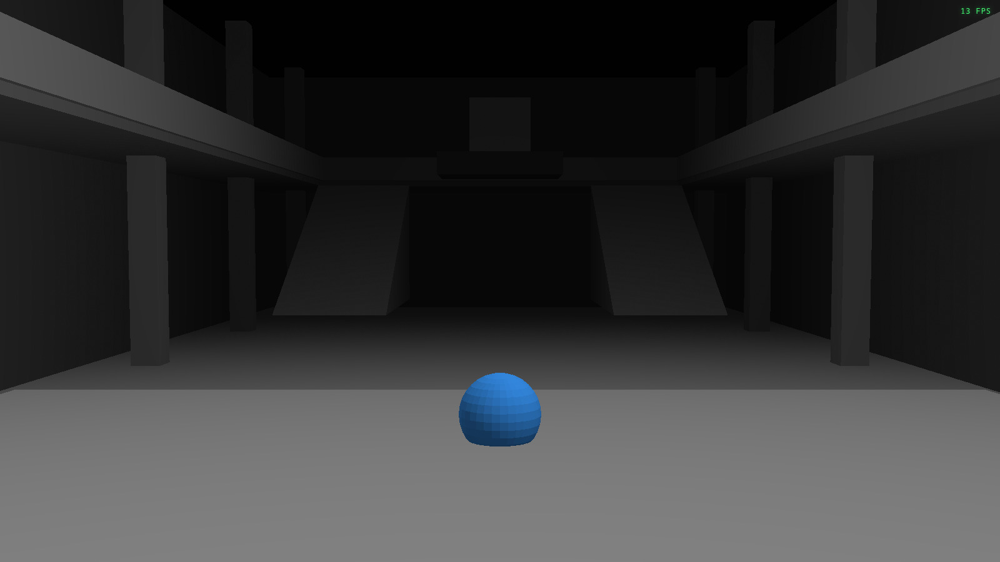

# Ink Ribbon

The real Raccoon Police Department geometry from *Resident Evil 2* (RT build),
floors 1–3, rendered in the browser with sokol compiled to WebAssembly. The
surfaces are not textured; each source material uses a distinct flat grey.
Orbit the model, pan it, or hold right-click and fly through it.

A green FPS counter sits at the top right of the scene.




## What is in here

- **Level data** — all 49 RPD terrain meshes for 1F, 2F and 3F, read directly
  from the game's PAK archives at LOD 0. This is the real level geometry: walls,
  floors, stairs, props, railings, roofs and the clock tower. There is no
  simplification pass and no texture data. All LOD-0 triangles from the 49
  meshes are kept; nothing is clipped, decimated or ceiling-trimmed. The
  moving-statue and crashed-helicopter gimmick meshes are appended as props.
- **Renderer** — a C application using the latest [sokol](https://github.com/floooh/sokol)
  (`sokol_app` + `sokol_gfx`), compiled to WebAssembly with Emscripten. It draws
  solid triangles in a simple key/fill/hemisphere light, with one flat grey per
  source material, then composites a restrained background gradient. No material
  textures are sampled.
- **Simple entrance** — `/simple` is a Blender-assembled blockout of the
  entrance hall. It replaces the decorative geometry with boxes, slabs and
  stair wedges while keeping the entrance proportions and the player-position
  sphere.
- **Whole-RPD blockout.** Floors 1 to 3 as one Blender scene. The source
  meshes stay in the scene as a wireframe reference. The simplified model adds
  floor plates, walls with full-height opening gaps, square pillars, stair
  wedges and ramp slabs. See [docs/blockout.md](docs/blockout.md). Build it with
  `npm run blockout` and view it at `/simple2`.
- **Web app** — React 19 + TypeScript on [Void](https://github.com/voidzero-dev/void)
  1.3.0 (Vite 8) targeting Cloudflare Workers. Once the scene is loaded the
  page is only the canvas; no labels or UI sit on top of it.

## Stack

| Part | Version |
|---|---|
| TypeScript | 7.0.2 |
| Vite | 8.3.5 |
| React / React DOM | 19.3.1 |
| Void SDK / CLI | 1.3.0 |
| sokol | `fe6e78dee2377e84bc6ade95f0dcd82b4fcd86e9` (2026-10-26) |
| Emscripten | 6.0.13 |
| Data builder | numpy |

## Run it

```bash
# Node 24.21+ is required by Void. If npm is configured with omit=dev,
# install the build tooling explicitly:
npm install --include=dev

npm run dev
```

Production build and local Worker preview:

```bash
npm run build
npm run preview
```

Rebuild the scene data from the installed game:

```bash
# 1. read the 49 terrain meshes from the RE2 RT PAK (68.5 MB, not committed)
uv run --with zstandard python tools/extract_rpd.py

# 2. build public/rpd/rpd.bin from data/raw/rpd
uv run --with numpy python tools/build_real.py

# 3. build the Blender simplified entrance
npm run simple

# 4. build the whole-RPD blockout, its /simple2 asset and the checks
npm run blockout
npm run blockout-render   # optional: overview, main hall and per-floor renders

npm run wasm   # only needed after changing native/main.c
```

`RE2_GAME_DIR` overrides the Steam install path. The extraction tooling is
derived from `~/repos/reze`; see [docs/extraction.md](docs/extraction.md).

## Controls

| Input | Action |
|---|---|
| Left drag | Orbit |
| Middle drag | Pan |
| Wheel / pinch | Zoom |
| Hold right click + mouse | Free-look |
| `W` / `S` (while flying) | Forward / back along the view |
| `A` / `D` (while flying) | Strafe left / right |
| `Q` (while flying) | Fly down |
| `E` (while flying) | Fly up |
| Scroll wheel (while flying) | Increase / decrease fly speed |
| `R` | Reset camera |
| One-finger drag | Orbit |
| Two-finger drag | Pan and pinch-zoom |

Right click seeds the fly camera from the current orbit view. Releasing the
button returns to orbit mode around a point ahead, so the transition is seamless.

## Deploy to Cloudflare

Void builds and deploys the app as a Cloudflare Worker:

```bash
npx void connect --platform cloudflare   # once, links the account
npm run deploy
```

`void.config.ts` pins the Worker compatibility date. The connected account is
written to `.void/` and `void.lock.json`; both are intentionally gitignored so
the repository does not contain an account ID. A fresh clone only needs
`void connect`.

## Layout

```
tools/extract_rpd.py       PAK lookup + extraction of the 49 RPD meshes
tools/re_pak.py            minimal KPKA v4 reader (Murmur3 path hashes)
tools/remesh.py            RE2 RT .mesh parser (LODs, groups, submeshes, buffers)
tools/build_real.py        real LOD-0 geometry, flat grey material palette, RPDW v3 writer
tools/extract_props.py     extract statue/helicopter gimmick meshes from the PAK
tools/export_entrance_obj.py  main-hall reference OBJ for Blender
tools/simple_blender.py    simple entrance boxes/wedges + OBJ export
tools/obj_to_simple.py     Blender simple OBJ -> RPDW v3 asset
tools/blockout_common.py   mesh loading, material names, shared types
tools/blockout_extract.py  source-fitted blockout spec and reference PLYs
tools/blockout_scene.py    Blender scene, OBJ/GLB export and renders
tools/blockout_verify.py   source-versus-blockout coverage and plan images
docs/blockout.md           whole-RPD blockout pipeline and results
tools/rpd_floor_meshes.txt exact PAK paths for floors 1-3
native/main.c              sokol app: camera, input, solid-colour geometry pass
native/third_party/sokol   vendored sokol headers (pinned commit)
native/build.sh            Emscripten build
src/RpdScene.tsx           React canvas + WASM loader with progress
src/wasm/rpd.js            generated Emscripten ES module (committed for deploy)
pages/index.tsx            real-geometry page
pages/simple.tsx           simplified entrance page (/simple)
pages/simple2.tsx          whole-RPD blockout page (/simple2)
public/rpd/rpd.bin         real RPD geometry + grey vertex colours (20.2 MB)
public/rpd/rpd.wasm        compiled sokol renderer
public/rpd/simple.bin      simplified entrance asset
public/rpd/simple2.bin     whole-RPD blockout asset
```

## Scene notes

The source meshes are in world space. Each room is a set of mesh groups; face
indices are relative to each material subdivision's vertex slice. The build:

1. reads every LOD-0 triangle from all 49 meshes;
2. assigns one of twelve grey shades to each source material index;
3. welds equal position+colour vertices into 19 chunks of at most 60k vertices;
4. quantises positions to 16 bits per chunk and packs the result as RPDW v3.

Raw source: 1,790,053 triangles and 2,059,499 vertices. After adding the
`sm41_024` statue and `sm46_011` crashed helicopter, the asset holds 1,874,521
triangles and 1,151,085 vertices in 20 chunks / 21.6 MB. Only the camera framing
bounds are restricted to the RPD area. The renderer
expands the chunks into one indexed mesh and draws it in a single call. No
textures, no simplification, no wireframe edge pass.

`/simple` imports the decompiled main-hall mesh into Blender as a reference,
removes it, and rebuilds the entrance from axis-aligned boxes, floor slabs and
two stair wedges. The Blender export is converted to a small RPDW v3 asset and
rendered by the same sokol application. The blue sphere is drawn at the
entrance by the renderer.

`build/rpd_blockout.blend` is the whole-RPD blockout. `RPD_Blockout` holds the
simplified model and `RPD_Reference` holds the original LOD-0 triangles as a
wireframe. Every primitive is fitted to the source coordinates, so the model
uses the original metres with no scale factor. The scene is Z-up with
`blender = (x, -z, y)`. `build/blockout/spec.json` records every slab, wall,
pillar, stair and ramp, and `build/blockout/verify/` holds the source-versus-
blockout plan overlays.

## Assets and licensing

The project code is MIT. The retail game assets remain the property of Capcom.
`data/raw/` is gitignored; the derived `public/rpd/rpd.bin` is included so the
demo runs without an installation. No original PAK files are redistributed.

Third-party: sokol (zlib/libpng), Emscripten (MIT/NCSA), React (MIT), Void
(MIT), numpy (BSD-3-Clause). The RE mesh layout was checked against
[NSACloud's RE Mesh Editor](https://github.com/NSACloud/RE-Mesh-Editor); no addon
code is vendored or called at runtime.
