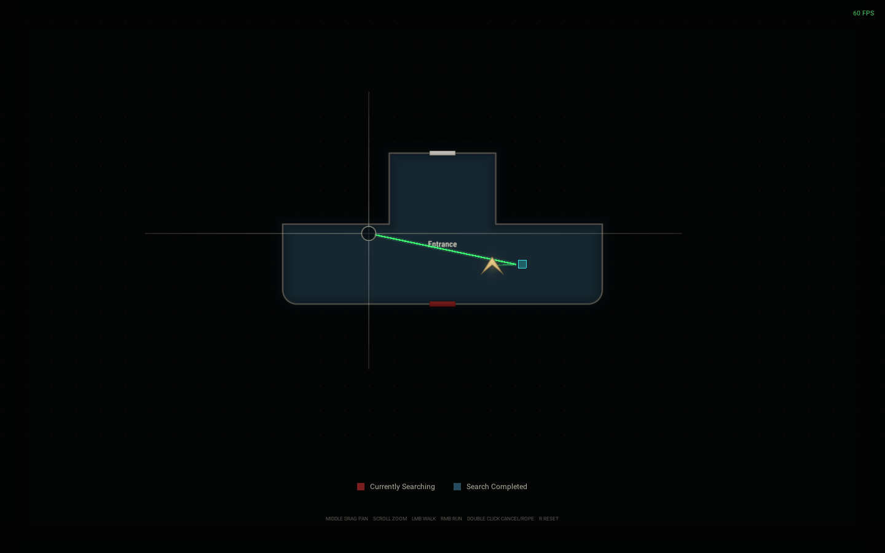

# Ink Ribbon

A black-on-white architectural model of the Raccoon Police Department from
*Resident Evil 2*, built in Blender from the calibrated evilresource floor plans
and rendered in the browser with sokol compiled to WebAssembly. All five floors
are present: **4F, 3F, 2F, 1F and B1**. The model is white card with charcoal
wall caps and an ink edge pass, so the top-down view reads like an architectural
plan and the perspective view reads like a paper model.

A fresh navigation graph is generated from the same plans — not copied from the
old decompiled meshes. Claire is a Dracula-pink capsule that walks the graph;
the route is planned in the orthographic plan view and runs when you double
click her.



## Controls

| Input | Action |
|---|---|
| `M` or the 3D/2D button | Animate between the perspective building and the top-down orthographic plan |
| Right drag | Orbit the perspective camera |
| Middle drag | Pan the perspective camera |
| Scroll wheel | Zoom (perspective camera or plan) |
| Middle drag (plan) | Pan the plan |
| Floor buttons | Choose 4F, 3F, 2F, 1F or B1; the plan clips to that storey |
| Click a room cell or stair | Preview a move, then click the popup to append a waypoint |
| Double click Claire | Run the committed route |
| `F` | Frame Claire |
| `Escape` | Pause and clear the route |
| `Space` | Move the camera to the hovered cell |
| `R` | Reset the perspective camera |

Routing only works in the plan view. The perspective view mirrors the same
route, waypoint cells and moving capsule without letting you place waypoints by
accident.

## How the building is made

`tools/rpd_plan.py` reads the five plans in `tools/rpd_plans/` (converted from
the evilresource GIFs). Each plan is calibrated to the game's world frame with a
pixels-per-metre scale and pixel origin:

| Floor | Image | px/m | origin px |
|---|---|---|---|
| 1F | 590×413 | 6.63 | (291, 240) |
| 2F | 561×259 | 6.45 | (262, 169) |
| 3F | 487×259 | 6.78 | (253, 176) |
| 4F | 100×52 | 6.78 | (−136.8, 137.4) |
| B1 | 639×337 | 6.45 | (333.45, 0.65) |

The 1F–3F origins are the result of matching the plan to the decompiled floor
geometry; the calibration was checked by projecting every named room into its
plan room. The 4F and B1 origins align their connection stair with the stair
they serve on 3F and 1F. Their internal layouts are the evilresource plans; only
the inter-floor offset is inferred.

For every floor the script:

1. separates the wall ink, the orange door blocks and the stair hatching;
2. closes the paired hairlines into solid walls and gives every wall a minimum
   width so it survives plan zoom;
3. flood-fills the plan from just inside its frame to find the exterior, then
   greedy-meshes the room slabs and the wall footprints into axis-aligned boxes;
4. gives each wall a charcoal cap (a 7 cm box on top) so the top-down view is a
   black line drawing and the perspective view is a white card model;
5. builds stepped treads at the stairwells and a flat floor slab at every level.

`tools/plan_scene.py` turns those boxes into one Blender object per floor,
saves `build/rpd_plan.blend`, and writes `public/rpd/rpd.bin`
(RPDW version 4) and `public/rpd/rpd.json`. The whole building is about 28k
vertices and 51k triangles.

## The navigation graph

`tools/rpd_plan.py` also lays a fresh 1 m lattice over each plan's walkable
area. Doors are walkable cells bridged to the rooms on both sides; stairwells
are replaced by ramp chains whose nodes carry intermediate heights, so A* can
cross floors without teleporting. The graph is written to `public/rpd/nav.json`
with per-floor bounds used by the plan camera. It holds about 5.5k nodes and
14.8k edges in one connected component that spans all five floors (a handful of
closet-sized rooms and one service stair are isolated by the source drawing).

The TypeScript A* in `src/nav.ts` is unchanged: it searches the 3D graph,
supports weighted vertical edges and returns the route points. `routeFromPath`
only removes collinear nodes and rounds corners, so the drawn route stays on
the walkable cells.

## Renderer

The C renderer in `native/src/` still draws one indexed mesh through
`rpd_scene.c`. Marker geometry lives in `rpd_markers.c`; the scene loader
accepts RPDW version 4 with any number of floors.

- `solid_fs_source` is a paper shader: albedo times a soft key/fill/hemisphere
  term, no fog and no glass.
- The offscreen target carries a second RGBA8 attachment with the view-space
  normal. The composite pass inks both colour discontinuities and normal
  discontinuities, so wall corners get a line even when two faces are shaded
  almost identically. Marker pixels write a sentinel normal so Claire stays
  outline-free. The result sits on warm off-white stock with a slight vignette
  and grain.
- `rpd_app.c` keeps one camera. `M` stores the perspective pose, flies it to a
  top-down pose over the active floor and blends the perspective and
  orthographic matrices with a smoothstep, so the switch is an animation rather
  than a cut. The floor clip ends below the next storey's slab so the floor
  above cannot hide the plan.
- The player marker is a capsule (`MARKER_CAPSULE`). `rpd_set_player_position`
  lifts it by half its height so it stands on the floor. The route overlay is
  drawn in screen space from the live view-projection matrix, so the same
  polyline appears in both projections.

## Web app

React + TypeScript on Void. `src/FloorMap2D.tsx` is now a headless orthographic
camera and label layer: it publishes the plan centre, scale and floor height to
the renderer and hosts the room labels. The overlay canvas draws the green hover
cell, cyan waypoint cells, dotted preview route, glowing committed route and the
Claire label in both views. Nav cells are no longer rendered.

The right panel always shows a 2×4 empty inventory grid. There is no route dock,
no glass toggle and no item markers yet; committing a waypoint only appends it
to the plan, and a double click on Claire's capsule starts the run.

## Run it

```bash
npm install --include=dev
npm run dev
```

Production build and local Worker preview:

```bash
npm run build
npm run preview
```

Rebuild the plan, the asset and the navigation graph:

```bash
npm run plan:build   # tools/rpd_plan.py + Blender export
npm run wasm         # only after changing native/
```

`npm run wasm` and `npm run plan:build` also write `public/rpd/version.json`, a
content hash of the bin, nav graph, quest data and wasm. The app fetches that
file with `no-store` and versions every asset URL with the hash, so a rebuilt
shader or graph is never served from an older browser cache.

The plan images are checked in at `tools/rpd_plans/`. The old decompiled-mesh
pipeline (`npm run data`, `npm run scene:*`, `npm run quest`) is kept for
reference but is not used by the page.

## Verification

```bash
npm run typecheck
npm run check:structure
npm run verify:rpd
```

`verify:rpd` boots the dev server and headless Chrome, drives the scene through
the five floors, adds a waypoint, double clicks Claire and checks the route is
walkable and completes, then compares thirteen screenshots against
`verification/rpd/baseline/`. Regenerate the baseline with `--update` after an
intentional visual change.

## Stack

| Part | Version |
|---|---|
| TypeScript | 7.0.2 |
| Vite | 8.3.5 |
| React / React DOM | 19.3.1 |
| Void SDK / CLI | 1.3.0 |
| sokol | `fe6e78dee2377e84bc6ade95f0dcd82b4fcd86e9` (2026-10-26) |
| Emscripten | 6.0.13 |
| Blender | 5.2.1 |
| Plan builder | Python 3, numpy, scipy, OpenCV |

## Layout

```
tools/rpd_plans/           calibrated evilresource floor plans (1f..b1.png)
tools/rpd_plan.py          plan calibration, masks, boxes and fresh nav graph
tools/plan_scene.py        Blender scene builder + RPDW v4 exporter
public/rpd/plan.json       box geometry for the Blender model
public/rpd/nav.json        five-floor walkable graph and floor bounds
public/rpd/rpd.bin         RPDW v4 paper model (five floors)
public/rpd/rpd.json        asset metadata: floors, bounds, triangle count
public/rpd/quest.json      room names, doors and links (items are not rendered)
native/src/rpd_app.c       camera blend, ortho clip and frame loop
native/src/rpd_scene.c     scene loading and rendering
native/src/rpd_markers.c   marker shapes (capsule, cube, pyramid, cylinder, door)
native/src/rpd_shaders.c   paper shader, ink composite, marker shader
src/nav.ts                 nav graph, A*, route points
src/planner.ts             pure plan simulation and previews
src/overlay/sceneOverlay.ts  screen-space hover, waypoints, route and popup
src/map/useMapCamera.ts    orthographic plan camera and focus animation
src/ui/QuestPanel.tsx      route instructions and the 2×4 inventory
```

## Assets and licensing

The project code is MIT. The retail game assets remain the property of Capcom.
The floor-plan drawings are derived from the
[Evil Resource police station maps](https://www.evilresource.com/resident-evil-2-remake/maps/police-station#policestation1f);
the visual language follows the supplied LINTEL black-and-white reference. The
old extracted meshes under `data/raw/` remain gitignored. No PAK files are
redistributed.

Third-party: sokol (zlib/libpng), Emscripten (MIT/NCSA), React (MIT), Void
(MIT), numpy (BSD-3-Clause), OpenCV (Apache-2.0), SciPy (BSD-3-Clause).
