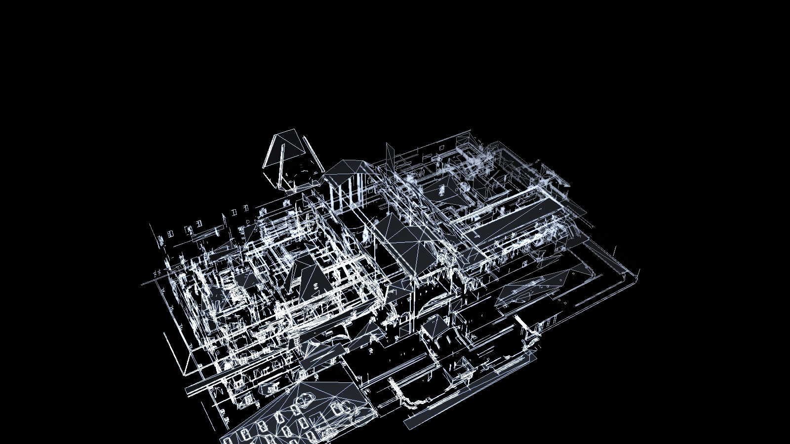

# Ink Ribbon

The real Raccoon Police Department geometry from *Resident Evil 2* (RT build),
floors 1–3, rendered in the browser with sokol compiled to WebAssembly. The
surfaces are not textured; each source material uses a distinct flat grey.
The default camera follows Claire from over her right shoulder. Moving the
pointer orbits around her, and the building camera orbits, pans and flies
through the model. The follow (inside) view uses the solid grey material shades;
the orbit and free (outside) views use translucent glass.

A green FPS counter sits at the top right of the scene. The same view is now a
playable Claire A quest map: walk the RPD, discover items, plot bright-green
routes, and use keys on locked doors.



## What is in here

- **Level data** — all 49 RPD terrain meshes for 1F, 2F and 3F, read directly
  from the game's PAK archives at LOD 0. This is the real level geometry: walls,
  floors, stairs, props, railings, roofs and the clock tower. There is no
  simplification pass and no texture data. All LOD-0 triangles from the 49
  meshes are kept; nothing is clipped, decimated, moved or ceiling-trimmed.
- **Editable scene.** `build/rpd.blend` holds the same geometry as one object
  per room, with one flat material per source material and a camera that frames
  the building. Edit the scene in Blender, then run `npm run scene:export` to
  rebuild `public/rpd/rpd.bin` from it. `build/` is gitignored, so the scene
  stays local.
- **Renderer** — a C application using the latest [sokol](https://github.com/floooh/sokol)
  (`sokol_app` + `sokol_gfx`), compiled to WebAssembly with Emscripten. It draws
  solid triangles in a simple key/fill/hemisphere light, with one flat grey per
  source material, then composites a restrained background gradient. No material
  textures are sampled.
- **Quest layer.** Claire A, Hardcore, RPD 1F–3F. `public/rpd/quest.json` holds
  every RPD item location from the Archipelago Claire A data, the key-to-door
  links taken from its region connections, 25 RPD doorways, and the room graph.
  `public/rpd/nav.json` holds a walkable surface graph sampled from the real
  floors, stairs and ramps. `public/rpd/grid.json` remains the flat
  cell source used to place items. The web app draws the graph, hides items
  until Claire walks near them, routes with A* over the graph, draws the route,
  and executes a confirmable move and action queue.
- **Web app** — React 19 + TypeScript on [Void](https://github.com/voidzero-dev/void)
  1.3.0 (Vite 8) targeting Cloudflare Workers. The canvas holds the 3D scene and
  a 2D grid and route overlay; the right panel is the quest planner.

## Stack

| Part | Version |
|---|---|
| TypeScript | 7.0.2 |
| Vite | 8.3.5 |
| React / React DOM | 19.3.1 |
| Void SDK / CLI | 1.3.0 |
| sokol | `fe6e78dee2377e84bc6ade95f0dcd82b4fcd86e9` (2026-10-26) |
| Emscripten | 6.0.13 |
| Data builder | Blender 5.2, numpy |

## Run it

```bash
# Node 24.21+ is required by Void. If npm is configured with omit=dev,
# install the build tooling explicitly:
npm install --include=dev

npm run dev
```

Production build and local Worker preview:

```bash
npm run build
npm run preview
```

Rebuild the scene data from the installed game:

```bash
# 1. read the 49 terrain meshes from the RE2 RT PAK (68.5 MB, not committed)
uv run --with zstandard python tools/extract_rpd.py

# 2. build build/rpd.blend from data/raw/rpd
npm run scene:import

# 3. pack the scene into public/rpd/rpd.bin
npm run scene:export

npm run wasm   # only needed after changing native/main.c

# rebuild the walkable cells, the quest data and the nav graph (Blender + Python)
npm run quest
```

`npm run data` runs all three steps. `npm run quest` runs
`tools/rpd_grid.py` to sample the flat item-placement grid from
`build/rpd.blend`, then `tools/rpd_quest.py` turns
`tools/rpd_ap_source.json` and that grid into `public/rpd/quest.json`, then
`tools/rpd_nav.py` samples every walkable surface into `public/rpd/nav.json`.
The nav step must run after the quest step because it binds AP doors to the
graph. To edit the level, open `build/rpd.blend`
after step 2, make your changes, then run step 3. The scene records the imported
triangle count and the export fails if the count changes. Update the
`rpd_triangles` custom property on the scene when the change is intentional.

`RE2_GAME_DIR` overrides the Steam install path. The extraction tooling is
derived from `~/repos/reze`; see [docs/extraction.md](docs/extraction.md).

## Quest map

The planner starts in the Main Hall on 1F. Items are invisible until Claire is
within 3 m, matching the "walk near to discover" rule. Click a floor cell to
move. Click a discovered item to draw a route and choose the actions that
happen on arrival. Click a door to route to it and, when a key is in the
inventory, add "Use <key> on <door>" to the queue. Press **Confirm** to move the
cyan player sphere and run the queued actions in order.

- **Item shapes and colours.** Keys are purple pyramids, key items magenta
  pyramids, healing green spheres, ammo yellow cubes, gunpowder orange cubes,
  weapons orange cylinders, upgrades teal cylinders, and ink ribbons white
  cylinders. The legend in the panel lists the current palette.
- **Doors.** Locked doors are red, unlocked doors blue, unknown doors grey.
  Locked doors list the item names that open them. A door with an item link
  shows the linked doors when its item is selected.
- **Floors.** The floor buttons switch the active grid between 1F, 2F and 3F.
  The player can still move to a cell on another floor. A* crosses real stair
  and ramp edges; it does not teleport between floors.
- **Coverage.** The scene contains RPD floors 1–3, so the quest layer covers
  the Claire A Hardcore locations in those floors. RPD B1 is not part of this
  scene and is excluded.

The location names, item ids and key requirements come from the
[RE2R Archipelago world](https://github.com/FuzzyGamesOn/RE2R_AP_World). The
door positions and walkable cells were checked against the room meshes in the
game PAK and the decompile at `~/repos/reze`.

## Controls

| Input | Action |
|---|---|
| Pointer move | Orbit around Claire in follow; orbit the building in orbit |
| Middle drag | Pan (orbit camera only) |
| `W` / `S` (while flying) | Forward / back along the view |
| `A` / `D` (while flying) | Strafe left / right |
| `Q` (while flying) | Fly down |
| `E` (while flying) | Fly up |
| Scroll wheel (while flying) | Increase / decrease fly speed |
| `C` | Toggle follow and orbit cameras |
| `P` | Toggle the right-side UI panel |
| `R` | Reset camera |
| Click floor cell | Route the player to that cell |
| Click discovered item | Route to the item and show its actions |
| Click door | Route to the door and show its lock state |
| One-finger drag | Orbit |
| Two-finger drag | Pan (orbit camera only) |

The camera orbits whenever the pointer moves over the scene; no button is
needed. The FOLLOW/ORBIT button in the floor bar switches cameras as well. The
route panel's focus button frames a plan in the free camera, where the fly keys
move the view. The follow (inside) camera renders the building with solid grey
material shades; the orbit and free (outside) views use translucent glass.
Opening the right panel dims the scene and blocks camera, movement and selection
input until the panel closes.

## Deploy to Cloudflare

Void builds and deploys the app as a Cloudflare Worker:

```bash
npx void connect --platform cloudflare   # once, links the account
npm run deploy
```

`void.config.ts` pins the Worker compatibility date. The connected account is
written to `.void/` and `void.lock.json`; both are intentionally gitignored so
the repository does not contain an account ID. A fresh clone only needs
`void connect`.

## Layout

```
tools/extract_rpd.py       PAK lookup + extraction of the 49 RPD meshes
tools/re_pak.py            minimal KPKA v4 reader (Murmur3 path hashes)
tools/remesh.py            RE2 RT .mesh parser (LODs, groups, submeshes, buffers)
tools/rpd_scene.py         Blender import of the 49 rooms and RPDW v3 export
tools/rpd_grid.py          flat 1 m item-placement cells sampled from the scene
tools/rpd_nav.py           walkable surface graph, stairs and ramps -> nav.json
tools/rpd_quest.py         builds public/rpd/quest.json from the AP data and grid
tools/rpd_ap_source.json   Claire A RPD regions, locations and door conditions
docs/extraction.md         PAK format, mesh format, Blender round trip and asset layout
tools/rpd_floor_meshes.txt exact PAK paths for floors 1-3
native/main.c              sokol app: camera, input, solid-colour geometry pass
native/third_party/sokol   vendored sokol headers (pinned commit)
native/build.sh            Emscripten build
src/RpdScene.tsx           React canvas, WASM loader, planner, grid and route overlay
src/nav.ts                  nav graph, A* search, door edge blocking, route points
src/quest.ts               quest types, room lookup, keys and route helpers
src/wasm/rpd.js            generated Emscripten ES module (committed for deploy)
pages/index.tsx            real-geometry page
public/rpd/rpd.bin         decompiled RPD geometry + grey vertex colours (20.8 MB)
public/rpd/rpd.wasm        compiled sokol renderer
public/rpd/grid.json       flat 1 m item-placement cells for 1F, 2F and 3F
public/rpd/nav.json        walkable surface graph for A* movement
public/rpd/quest.json      Claire A RPD items, doors, links and room graph
```

## Scene notes

The source meshes are in world space. Each room is a set of mesh groups; face
indices are relative to each material subdivision's vertex slice.
`npm run scene:import`:

1. reads every LOD-0 triangle from all 49 meshes;
2. welds equal vertices into one mesh object per room, named by room stem;
3. gives each room one material per source material, named after that material,
   with one of twelve flat grey colours;
4. saves `build/rpd.blend` with a camera and a sun that frame the building.

`npm run scene:export`:

1. reads every mesh object in the scene and converts positions back to source
   metres;
2. takes each material's `diffuse_color` as the face colour;
3. welds equal position and colour vertices into 19 chunks of at most 60k
   vertices;
4. quantises positions to 16 bits per chunk and packs the result as RPDW v3.

The scene is Z up, and `blender = (x, -z, y)` maps source metres (Y up) to
Blender. The import bakes that map into the vertex positions, so imported
objects have identity transforms. Export ignores the camera, the sun and any
other non-mesh object.

Raw source and asset are the same: 1,790,053 triangles and 1,116,068 vertices
in 19 chunks / 20.8 MB. `rpd.json` records the method, per-floor bounds, chunk
counts and the geometry filter. Nothing is appended, moved or removed. Only the
camera framing bounds are restricted to the RPD area. The renderer expands the
chunks into one indexed mesh and draws it in a single call. No textures, no
simplification, no wireframe edge pass.

## Assets and licensing

The project code is MIT. The retail game assets remain the property of Capcom.
`data/raw/` is gitignored; the derived `public/rpd/rpd.bin` is included so the
demo runs without an installation. No original PAK files are redistributed.

Third-party: sokol (zlib/libpng), Emscripten (MIT/NCSA), React (MIT), Void
(MIT), numpy (BSD-3-Clause). The RE mesh layout was checked against
[NSACloud's RE Mesh Editor](https://github.com/NSACloud/RE-Mesh-Editor); no addon
code is vendored or called at runtime.
