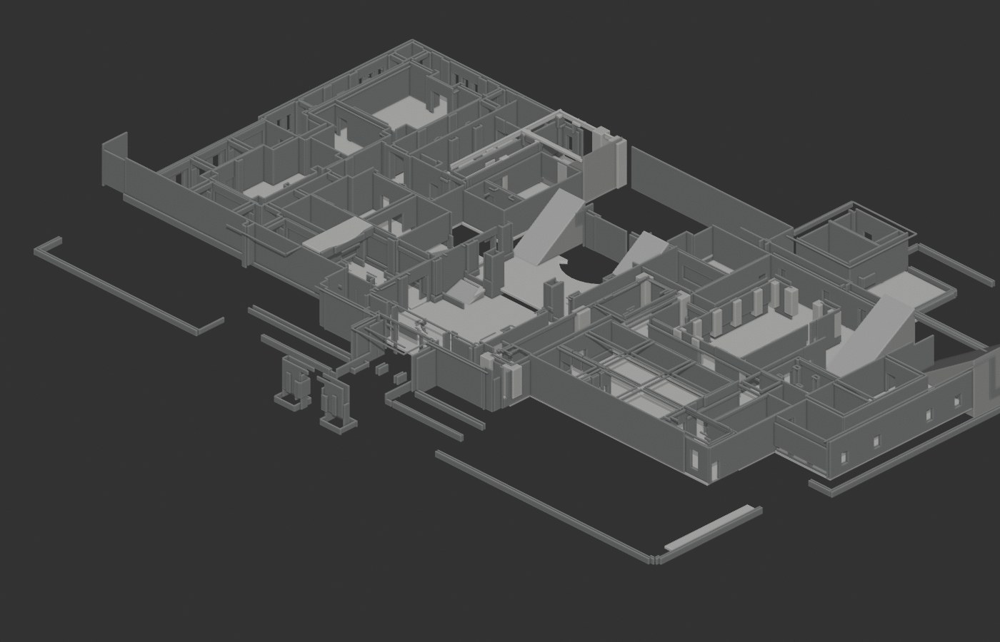
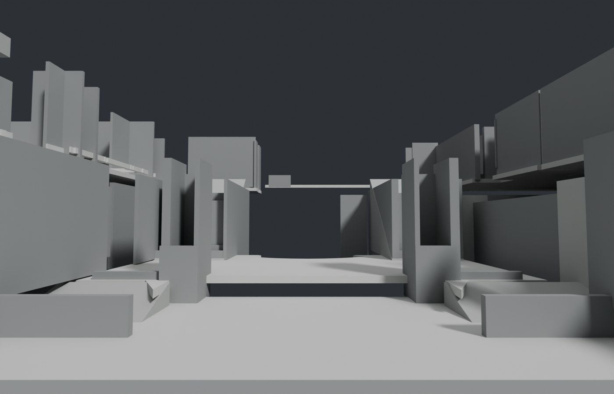
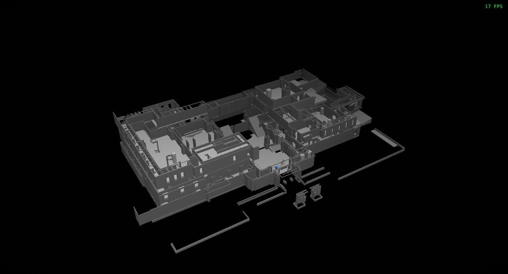
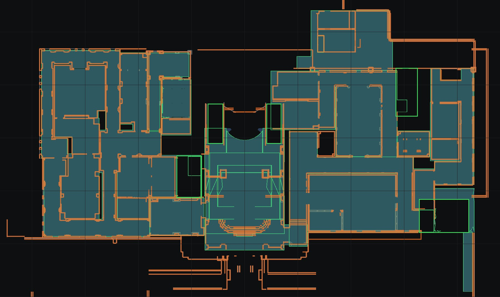
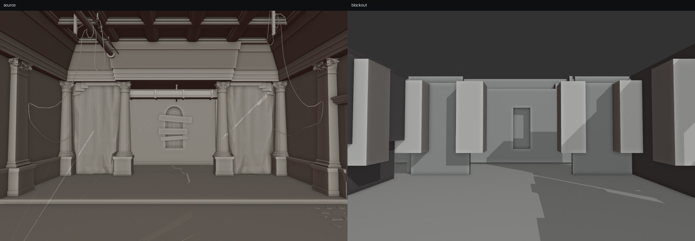

# Whole-RPD blockout

A simplified Blender model of the Raccoon Police Department, floors 1 to 3,
built from the decompiled level meshes. Every primitive sits on coordinates
taken from the source geometry. Nothing is traced from a map or placed by eye.

The model is a dollhouse blockout. It has floor plates, walls with door and
window openings, square pillars and stair wedges. It has no roofs, ceilings,
furniture, railings, statue or other props.





## What is generated

```
build/rpd_blockout.blend        Blender scene, source meshes as a wireframe reference
build/blockout/blockout.obj     blockout only, source coordinates, Y up
build/blockout/blockout.glb     same model, glTF Y-up
build/blockout/spec.json        every primitive and its source-derived coordinates
build/blockout/reference/       the decompiled meshes used as the reference
build/blockout/renders/         overview, main hall, and one render per floor
build/blockout/compare/         source-versus-blockout room renders
build/blockout/verify/          source-versus-blockout plan overlays and metrics
public/rpd/simple2.bin          blockout asset for the /simple2 page
public/rpd/simple2.json         blockout asset metadata
```

The current spec holds 41 floor slabs, 2,939 wall boxes, 64 pillars and 11
stair wedges. Every wedge spans the storeys it serves, so eleven wedges cover
the whole building: the two grand flights, three stairwells split across
floors, the two long east ramps and the west office stair.



The web page at `/simple2` loads `public/rpd/simple2.bin`, converted from
`build/blockout/blockout.obj` by `tools/obj_to_simple.py`. `npm run blockout`
builds the asset as part of the pipeline. The asset keeps the source metres and
uses a 6 m padding on its framing bounds so the default camera shows the whole
blockout. The page is `pages/simple2.tsx`.

The `.blend` scene has two collections:

- `RPD_Blockout`, with `F1`, `F2` and `F3`. Each floor has floor slabs, walls,
  pillars, stairs and ramps.
- `RPD_Reference`, with `Ref_F1`, `Ref_F2` and `Ref_F3`. These are the original
  LOD-0 triangles inside the RPD area, drawn as a wireframe and hidden from
  render. The reference keeps every triangle inside x -46 to 48, z -36 to 20
  and y -2 to 22, which covers the building and its immediate grounds.

Toggle the reference collection to check the blockout against the source.

## Coordinates and scale

The game stores the level in metres with Y up. The blockout spec keeps that
space. The Blender scene is Z up and maps

```
blender = (x, -z, y)
```

The source triangle positions are used directly. No scale factor is applied.
The detected floor plates sit at the same heights as the source floors:

| Floor | Source floor levels (m) | Spec slab levels (m) | Wall band (m) |
|---|---|---|---|
| 1 | -0.01, 0.78 | 0.00, 0.76 | -1.2 to 4.6 |
| 2 | 4.77, 5.18, 8.57 | 4.82, 5.20, 8.60 | 3.9 to 9.4 |
| 3 | 10.38, 13.98 | 10.40, 14.00 | 9.2 to 14.8 |

Floor 2 carries three plate heights because the main-hall gallery at 5.20 sits
below the east mezzanine at 8.60. The two grand flights rise from 0.76 to 5.20
at x -6.94 to -4.01 and 4.11 to 6.94, z -16.41 to -8.90, and land on the
gallery. That gallery lives in the floor-1 hall mesh in the source, which is
why floors are keyed by height rather than by room.

## How the primitives are derived

The extraction reads `data/raw/rpd/*.mesh` and uses the material name table in
each file. Material names are mapped through the per-file material index
remap at header offset `0x60` and the name table at `0x78`.

- **Floor plates.** A floor is keyed by its height, so every source mesh
  contributes. This matters because the main-hall gallery at 5.20 m is stored
  in the floor-1 hall mesh, and a room-keyed pass would miss it. Up-facing
  floor-material triangles are binned by height in 10 cm slices. Peaks over
  2 m2 become plate levels. Each triangle joins its nearest level within
  0.35 m, so adjacent split levels leave no gap. Each level is unioned in plan,
  holes under 1.6 m2 are filled, and the outline is extruded 25 cm down. Walls,
  pillars, frames, counters, sills and ceilings are excluded from the plate
  set, because their tops are not floors.
- **Walls.** A wall is keyed by its room, because one tall wall spans every
  height band and each room mesh already owns it once. Vertical triangles from
  structural materials are grouped into planes on their dominant axis, with an
  11 cm plane tolerance. Each plane is rasterized at 3 cm with real triangle
  coverage, not bounding boxes, so arch and doorway voids stay open. A run is
  solid when it covers the 1.0 to 2.0 m band. Door runs get a lintel above
  their opening, and window runs get a sill and a lintel. Both wall faces are
  kept as 0.16 m boxes, and the exterior police shell is included. Runs shorter
  than 0.25 m are dropped.
- **Pillars.** Pillar-material triangles are clustered in plan. A cluster is a
  pillar when its footprint is 0.2 to 2.1 m on a side, at least 1.5 m tall,
  and covers at least 4 percent of its bounding box. It becomes one box.
- **Stairs.** A stair is a 3D object that crosses height bands, so it is
  detected once over the whole building instead of inside a band. Flights come
  from stair-material clusters and from chains of small horizontal treads whose
  heights rise in 8 to 45 cm steps. Each flight's rise is measured on every
  source triangle it contains, then snapped within 0.6 m to a storey level.
  A flight that passes a storey is split there, so one stairwell becomes one
  wedge per floor and every wedge starts and ends on a plate.
- **Landings.** A switchback turns on a landing that the stair mesh carries,
  not a floor plate. Where a flight ends with no slab within 0.35 m, a landing
  plate is added at that height over the flight footprint, merged with any
  other flight ending in the same place. Landings are excluded from the storey
  level check.
- **Ramps.** Up-facing triangles with a tilted normal, a fitted plane residual
  under 9 cm, a slope under 0.5, a run of at least 2.5 m and a rise of at least
  0.5 m become thin sloped slabs. On this level set every sloped run is part of
  a stair, so nothing survives that filter and the spec holds no ramp slabs.

Two dimensions are blockout conventions rather than source measurements. A
wall face with no paired opposite face becomes a 0.16 m box, and a low wall is
capped at 0.95 m. Everything else uses source coordinates.

## Verify

```bash
npm run blockout
```

This regenerates `spec.json`, the reference PLYs, the Blender scene, the OBJ
and GLB, and the verification report. It does not render. To render the six
views:

```bash
npm run blockout-render
```

The render uses Blender Workbench for the plan-style views and Cycles for the
main hall, so the whole set finishes in about a minute.

The verification rasterizes the source and the blockout at 5 cm per pixel.
It reports source-versus-spec coverage per floor. A point counts as covered
when it lies within 8 cm of a floor surface, or 20 cm of a wall centreline.
The run fails, with a nonzero exit, when floor recall drops below 0.99, solid
wall precision below 0.85, solid wall recall below 0.90, wall footprint
precision or recall below 0.95, a floor level misses the independent source
estimate by 0.20 m, the bounds exceed the source by more than 0.50 m, a stair
wedge has no source tread, a stair wedge does not reach a slab at both ends,
or a pillar or ramp has no source geometry.

Stair footprints are cleared from both floor masks at raster resolution, so a
slab under a stairwell is neither credited nor penalised. Without that the
floor score compares a room-keyed source mask against a height-keyed spec mask
and reads correct floors as extra.

Current result:

| Floor | Floor precision | Floor recall | Solid wall precision | Solid wall recall | Footprint precision | Footprint recall |
|---|---|---|---|---|---|---|
| 1 | 1.000 | 1.000 | 0.963 | 0.989 | 0.997 | 0.994 |
| 2 | 1.000 | 0.997 | 0.981 | 0.959 | 0.997 | 0.976 |
| 3 | 1.000 | 0.999 | 0.974 | 0.987 | 0.999 | 0.959 |

Floor precision is 1.000 because stair footprints are cleared from both masks
and every other plate comes from a source floor triangle. Floor recall is the
completeness number. The solid wall score is the mid-height wall band.
The footprint score compares every wall box and every source wall face in plan,
which is the wall-for-wall test. Pillar boxes count as wall coverage because a
pillar face is a vertical box too. What the footprint score still misses is
scattered sub-metre slivers from trim, curved apses and short wall ends, not
whole walls. The plan overlays in `build/blockout/verify/plan_f*.png` show them
directly.

The same run checks every spec floor level against a histogram of the source
floor surfaces. All spec levels match a source level within 0.20 m. Bounds are
checked against the source structural bounds with a 0.50 m margin. The source
bounds are wider than the spec because the reference geometry includes trim
and the stair meshes, which the blockout replaces with wedges.





Stair connection, measured against the slab level set:

| Floor | Flights | Both ends on a slab |
|---|---|---|
| 1 | 5 | 5 |
| 2 | 5 | 5 |
| 3 | 1 | 1 |

The connection check is what catches a flight that rises only part way. Tread
coverage is still reported per flight, but it counts every up-facing source
triangle inside the footprint, including plates on other floors, so it is a
prompt to look rather than a gate.

## Compare rooms

```bash
npm run blockout-compare
```

This loads `build/rpd_blockout.blend`, renders the source and the blockout from
the same camera for 12 room and corridor views, and writes side-by-side and
50/50 overlay images under `build/blockout/compare/`. Most camera positions are
derived from the source room floor polygons with an inscribed-circle fit, so a
view cannot start inside a wall. The two main-hall views are placed by hand
because the hall needs an eye line up the grand staircase.

Stairs use a warm tint in the renders and in the scene materials, so
circulation reads at a glance against the neutral floors and walls.

## Pillars

Every one of the 64 pillar boxes contains source vertical geometry. The check
is a containment check, not an independent shape comparison, because the boxes
are fitted to the same source triangles. The spec holds no ramp slabs; see
Ramps above.

## Half walls

Half-height walls are reported separately. Most of them are balcony parapets
and low partitions, and the source low-band mask also contains stair sides and
railings, so its recall is not a main-shape target.

| Floor | Half-wall precision | Half-wall recall |
|---|---|---|
| 1 | 0.893 | 0.283 |
| 2 | 0.832 | 0.119 |
| 3 | 0.496 | 0.134 |

## Limits

- No roofs or ceilings. The model is meant to be read from above.
- Door and window openings keep a lintel at the source opening height, and
  windows keep a sill as well. Frames and glazing are not modeled.
- Props, railings, furniture and the statue are not modeled. The library
  bookcases and gallery joinery are furniture and are omitted; the stair ramps
  to the gallery remain.
- Curved arches and the main-hall apse are approximated by axis-aligned walls
  and rectangular openings. Decorative arches, ceilings, the statue and
  furniture are not modeled.
- Curved and diagonal walls are approximated by axis-aligned boxes. Walls
  shorter than 0.25 m and openings narrower than that are dropped.
- The garage levels below floor 1 are outside the blockout band.

## Rebuild from the game install

`data/raw/rpd/` is not committed. Recreate it first:

```bash
uv run --with zstandard python tools/extract_rpd.py
```

Then run `npm run blockout`. It writes the Blender scene, the `/simple2`
asset and the verification report. Blender 5.2 or newer is required. Open
`/simple2` after `npm run dev` to view the blockout in the app.
